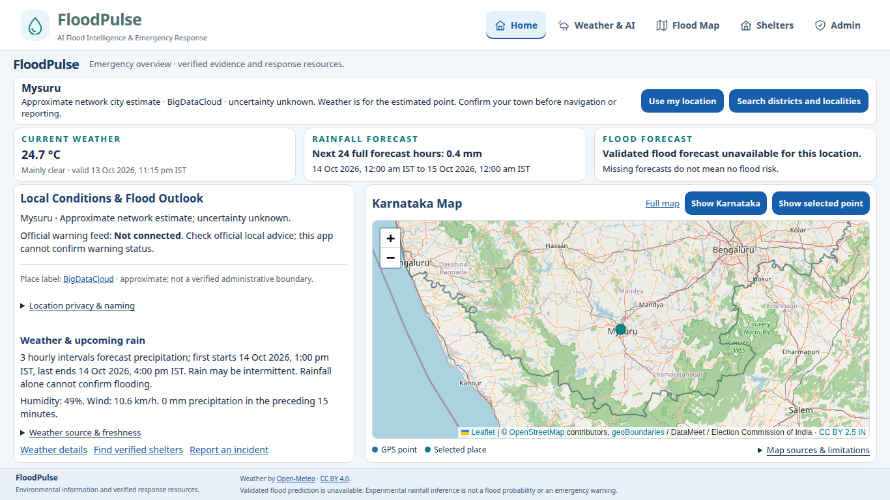
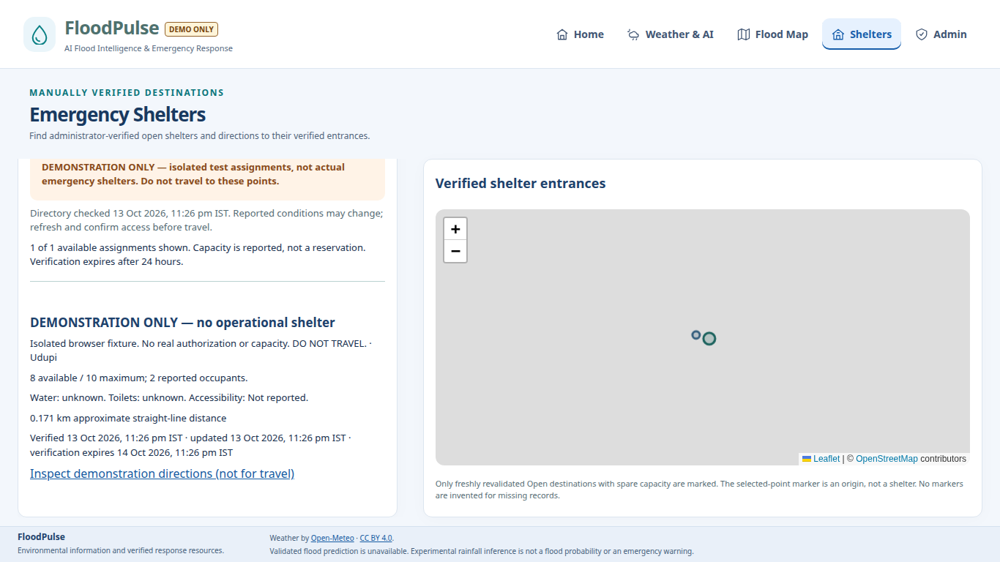

# FloodPulse final application verification

**Audit:** 13 October 2026 (IST). **Target demonstration:** 16 October 2026.

**Baseline commit:** `15841d1f7d53d01318303efe5a4ebf2d02a4543d`, branch `feature/karnataka-data-foundation`.
**Scope:** existing local application at `http://127.0.0.1:14180`, PostgreSQL/PostGIS, installed Google Chrome and isolated demonstration workflows. No product features or model training added. This is a bounded verification, not a claim of an exhaustive penetration test or an operational emergency service.

## 1. Feature-by-feature results

| Area | Executed result | Evidence class / limits |
|---|---|---|
| Existing staff account | One active administrator exists in the intended migration-0006 database | **Real integration passed**, read-only account count; no username/password exposed |
| Compromised password rotation and current live authentication | The user explicitly deferred private rotation/live authentication; no compromised-password login attempted | **Blocked by private rotation**; earlier setup verification is not reused as current authentication proof |
| Authentication controls | Original secure provisioner, scrypt, opaque HttpOnly/SameSite sessions, logout revocation, inactive/expired sessions, login limits and CSRF passed | **Isolated demonstration / security tests passed**; actual database/API persistence, with fresh throwaway credentials |
| Authorization and roles | Anonymous protected APIs denied; restricted service roles cannot create schema/admins, mutate audit history or write the public directory | **Real read-only privilege checks and isolated denied writes passed** |
| Home automatic location | Actual Chrome's native GPS attempt timed out (code 3); Home then displayed Mysuru as an approximate BigDataCloud network estimate with unknown uncertainty | **Real integration passed for honest fallback; native GPS failed**. This does not verify the device's actual town |
| Automatic weather | Accepted network-estimated point automatically loaded actual Open-Meteo weather, HTTP 200 | **Real integration passed**. Current weather is model output, not a station observation |
| Weather and rainfall | Independently checked exactly 24 consecutive one-hour intervals: network-estimated point 0.4 mm; selected Kundapur 0 mm. Both windows 14 Oct 00:00–15 Oct 00:00 IST | **Real integration passed**; issue time remains unavailable, zero rain is not zero flood risk |
| Desktop/mobile | Actual Chrome 1366×768 at device scale 1: document 1366×768, no page errors; 390×844 mobile captured; full viewport/accessibility regressions passed | **Real sessions plus isolated layout tests passed** |
| Failed-provider handling | Timeouts, stale receipts, absent/null hourly values, unavailable model/reverse/geographic responses and bounded retries passed | **Mock-only failure simulations passed**, no fabricated fallback data |
| Flood photo report | Actual UI→restricted PostGIS: explicit manual point, estimated 250 m radius, owned PNG, private SUBMITTED receipt→UNDER_REVIEW→APPROVED with reason/audit | **Isolated demonstration passed**; no real flood observation or operational report created |
| Drainage photo report | Actual Chrome CDP GPS fixture 1250 m uncertainty; owned 24×18 JPEG with encoded EXIF; private submission→review→REJECTED→withdrawal | **Isolated demonstration passed**. CDP coordinates and embedded EXIF are explicit fixtures, not actual sensor measurements |
| Privacy and image evidence | Anonymous/private-photo denial; authenticated sanitized photo access audited; real format/dimensions/hashes/consented EXIF decoded; MIME spoofing/malformed/oversized inputs refused | **Actual isolated API/PostGIS and offline file tests passed**. No image-content classifier, water-depth or severity analysis exists |
| Evidence export | Approved flood evidence downloadable only with authentication; rejected/withdrawn evidence excluded; training_eligible=false, NOT_ASSESSED, negative_labels=false | **Isolated demonstration passed**. Approval is reviewed citizen evidence, not confirmed flood ground truth or training consent |
| Withdrawal/retention | Withdrawal deletes photo/private position/metadata and preserves audit; expired photo access refused; 30-day evidence redaction and mode-scoped purge passed | **Isolated tests passed**. Physical expiry purge is administrator-triggered, not an automatic scheduled deletion |
| Shelter administration | Actual Chrome map click, Pending→four renewed confirmations→Open→public listing→Closed→public removal; capacity/status/expiry/revision/audit rules passed | **Isolated demonstration passed**; fictional capacity/authorization remain explicitly labelled, not operational facilities |
| Existing development shelter | One live-mode Open administrator-entered record already existed and was preserved | **Read-only existence/status check passed**; physical authorization, entrance condition and capacity were not independently corroborated by this audit |
| Shelter origin/directions | Explicit reviewed locality origin and exact selected entrance encoded; fresh availability check, 5-second link window, uncertain/stale origins refused | **Isolated demonstration passed**. Straight-line distance is not road distance |
| External directions | First Google navigation attempt timed out at 25 s; one bounded retry returned HTTP 200, actual walking-route geometry 450 m/~6 min via Kundapura Main Rd | **Real provider integration passed after transient failure**, for demonstration points only; provider building labels confer no shelter authorization |
| Route safety | UI limitations preserved; no authoritative current closure/hazard/access coverage was supplied | **Not certified flood-safe**; no road safety or flood avoidance claim is permitted |
| Telegram administration | Exact preview/approval, opt-in/out, dedupe, durable single-attempt claim, audit, recipient recheck and accepted/rejected/unknown outcomes passed | **Mock-only delivery tests with real isolated DB transactions passed**; browser preview/send responses use explicit fixtures |
| Telegram live delivery | Token, destinations, webhook secret and bot username absent from running API configuration; no consenting/authorized live recipient supplied | **Blocked by configuration/consent**. Zero real messages sent, no actual provider delivery receipt claimed |
| Experimental indicator | Live saved rainfall_logistic_v1 inference for exact supported Kundapur point, HTTP 200; correctly labelled Experimental Heavy-Rainfall Indicator | **Real integration passed**; ERA5 proxy/live-input parity and low retrospective precision remain visible; not flood occurrence/probability or an official warning |
| Scientific integrity | Saved model hash/provenance/held-out inference reproduced without fitting; historical evidence and scientific NO-GO preserved | **Read-only validation passed**; no statewide flood classifier or promoted training labels introduced |

## 2. Screenshots from actual application sessions

These are real rendered Chrome sessions. Home is the running development application. Report/shelter images show labelled isolated records. The Google screen contains provider output for fixture endpoints. Operational staff identity/credentials, private real evidence and internal shelter records are excluded from committed screenshots.

| Screenshot | Session / interpretation |
|---|---|
| [Automatic desktop Home](verification/2026_10_13/home-automatic-desktop.png) | Live approximate-network naming, actual weather and 1366×768 layout |
| [Automatic mobile Home](verification/2026_10_13/home-automatic-mobile.png) | Actual 390×844 mobile session |
| [Selected Kundapur Home](verification/2026_10_13/home-selected-desktop.png) | Actual selected-point weather, distinct from flood prediction |
| [Flood submission](verification/2026_10_13/demo-flood-submission.png) | DEMO ONLY manual point/photo, private receipt |
| [Flood approval](verification/2026_10_13/demo-flood-approval.png) | Real isolated moderation and approved evidence export |
| [Drainage rejection](verification/2026_10_13/demo-drainage-rejection.png) | Real JPEG/EXIF extraction, coarse GPS fixture and rejected status; unavailable background tiles explicitly announced |
| [Shelter administration](verification/2026_10_13/demo-shelter-administration.png) | Isolated map-selected entrance, explicit verification controls |
| [Shelter directions](verification/2026_10_13/demo-shelter-directions.png) | Exact fixture entrance, freshness, availability and do-not-travel warning |
| [Telegram unavailable](verification/2026_10_13/telegram-unconfigured.png) | Real application configuration response; no message sent |
| [Google directions](verification/2026_10_13/google-directions-demo-points.png) | Actual provider attribution/route geometry, not flood-safe certification |





Additional private receipts, screenshots, calculation records and raw test logs remain in owner-only `/tmp/floodpulse-final-verification`. Restricted exports/password/session values are not committed. Native camera hardware was not exercised; the actual browser gallery-upload path and action-gated camera input are verified separately.

## 3. Database and migration health

The existing `floodpulse_directory` database on 127.0.0.1:55436 runs PostgreSQL 16.4/PostGIS 3.4.3 at `0006_report_position_provenance`. No persistent migration, downgrade, role/grant change, reset, shelter/report seeding or destructive penetration test was performed. One active administrator and one existing live-mode Open shelter were observed at audit start; no operational citizen report existed.

Both service roles have no superuser/role-creation/database-creation/schema-CREATE capabilities. The directory role cannot INSERT the active directory. The application role has all 14 required table privilege groups but cannot INSERT/UPDATE administrator accounts or UPDATE/DELETE audit tables. Finite grants and unauthorized writes were tested in UUID-isolated databases. Maintenance URL absent from running API; maintenance/database/bot credentials absent from Vite. Live Telegram/routing/imagery readiness was checked by configuration-key presence only, without reading values into tool output.

All migrations were replayed and relevant schema/index/constraint/sentinel/account-preservation checks passed in a fresh PostGIS 16 test container on 55444. Test schemas/databases/roles are UUID-owned and cleaned independently of the development database. Original tables, migration sources, models and research files are protected by baseline fingerprints; final comparison results are recorded below.

## 4. Security findings by severity

| Severity | Finding | Status / necessary action |
|---|---|---|
| **High** | Existing staff password was disclosed outside the secure login interface | **Open — private rotation/live checks deferred by user**. Use the original maintenance provisioner with reset=True, require a different private password, revoke all prior sessions, then verify actual Chrome login/logout. Never reuse the exposed password or publish credentials. Live authenticated checks remain gated |
| **Medium** | Physical retention purge requires an administrator action; no scheduled purge is implemented | Access expiry/redaction and explicit purge are tested. Assign an operator to apply expired-evidence retention; do not advertise automatic physical deletion |
| **Medium** | Real facility authorization/capacity/access and current route hazard/closure evidence are not independently verified here | Preserve the existing record; have the designated operator verify evidence and renew 24-hour availability before 16 October. Do not present fixtures, generic road routes or provider place labels as operational guarantees |
| **Low** | Native GPS timed out and external Google navigation initially timed out | Network/manual fallback and accurate labels work; have explicit manual starting-point selection available and check provider connectivity before the demo |
| **Low** | Weather payload requested-point source is generic user_selected_wgs84_coordinates even for frontend network estimates | Frontend correctly preserves network-source/uncertainty labels. Do not infer a verified human-selected locality or administrative identity from the coordinate payload alone |
| **Informational** | Street tiles can fail; satellite/MapTiler and in-app ORS configuration are absent | Geometry/selection and clear tile-unavailable notices remain usable; no substitute tiles/imagery/road geometry fabricated |
| **Informational** | Vite >500kB bundle advisory and existing Starlette/httpx deprecation | Build/tests passed. These did not prevent verification |

No critical application-code defect was reproduced in the executed checks. Password exposure is a real security incident requiring rotation, not a reason to rebuild or weaken authentication. The audit is not an assertion that every possible vulnerability has been excluded. SQL bindings, validation, same-origin/CSRF checks, private image object access, secret-redacted errors and restricted database writes were examined/tested; destructive attacks against operational data were excluded.

## 5. Executed tests and real versus simulated functionality

| Check | Result |
|---|---|
| Full backend/security suite | **1,455 passed**, one actual model-fitting reproduction deliberately deselected; no training performed |
| Full frontend suite | **275 passed /25 files** |
| Full PostgreSQL/PostGIS integration | **67 passed** in isolated UUID databases |
| Full Playwright using installed Google Chrome | **83 passed** in 4.8 minutes |
| Focused flood/drainage/GPS browser rerun | **3 passed** after correcting one audit expectation |
| Self-contained JPEG fixture + reusable Chrome audit configuration | **1 passed** |
| Production build | **Passed**; 690.59 kB JS bundle advisory |
| Saved-model scientific validator | **Passed**, 8,768 rows checked, held-out inference reproduced, refitted=false |
| Live public Chrome | **Passed** for approximate automatic location/weather, selected weather, experimental inference, exact desktop layout and mobile capture; native GPS timeout recorded |
| Live existing-account Chrome after private rotation | **Blocked — explicitly deferred by user**, no stale prior success substituted |
| Live Google directions | **Passed on bounded retry**; first 25 s timeout retained |
| Live Telegram delivery | **Blocked**, no configured consenting destination/provider send |

The first full Chrome run had 82 passes and one new audit assertion failure: expected 410 after withdrawn-photo deletion, received the correctly private 404. Source inspection confirmed 404 is the existing contract; no product fix was required. Corrected assertion passed, followed by the full 83-test run. The new test's initially external JPEG dependency was replaced with a self-contained, owned uniform-colour JPEG fixture containing explicit test-only EXIF. Static image bytes, CDP GPS and fictional shelters are demonstration fixtures, not real incidents/sensor readings.

Regression provider failures/Telegram responses are mocked in isolated tests. The main flood/shelter journey and drainage journey use actual API/PostGIS transactions, restricted roles, original password/session handling and real image decoding; their field observations/authorization/capacity are explicit fixtures. Open-Meteo selected-point weather and saved-model inference are live. No actual Telegram acceptance/delivery/reading claim follows from mocked sender responses.

For repeat verification, configure a private maintenance URL for a separate authorized test PostgreSQL/PostGIS service, then run from the repository root:

```bash
backend/.venv/bin/python -B -m pytest backend/tests -q \
  -k 'not test_real_training_reproduction_chronological_split_and_actual_metrics'
backend/.venv/bin/python -B -m pytest backend/integration_tests -q
backend/.venv/bin/python -B scripts/verify_mvp_e2e.py \
  --config=playwright.audit.config.js tests
(cd frontend && npm test && npm run build)
backend/.venv/bin/python -B scripts/validate_saved_rainfall.py
```

Maintenance connections are kept private and removed from the API/browser environment. The test runner never seeds/drops the configured application's database; it creates and cleans only its own UUID database and roles. Actual Chrome must be installed. Do not run operational destructive tests, fit the excluded model or paste credentials into commands/history.

## 6. Exact remaining blockers

1. The user explicitly requested leaving live authentication blocked. Private password rotation/session revocation and post-rotation live existing-account authentication remain unexecuted; no new receipt exists. The private maintenance prerequisite was prepared but not run, and no default/replacement secret was invented.
2. Real shelter authority, entrance condition, capacity/occupancy/usability and expiry renewal require the designated operator's evidence review. No such physical verification can be inferred from this software test.
3. Telegram lacks TELEGRAM_BOT_TOKEN, TELEGRAM_DESTINATIONS, TELEGRAM_WEBHOOK_SECRET and TELEGRAM_BOT_USERNAME, a configured HTTPS webhook and one explicitly consenting/authorized recipient. No real send is authorized by this audit alone.
4. Native precise GPS and actual camera hardware were not verified on this device. Coarse/denied/timeout/manual behavior and browser gallery upload are verified; actual Chrome CDP GPS fixtures must be described as simulated sensor input.
5. Current authoritative road hazards/closures/access data are absent. OPENROUTESERVICE_API_KEY is not configured; external Google directions work generically but cannot be certified flood-safe. Optional MapTiler imagery/building search is also unconfigured.
6. Official warning feed/verified river coverage and scientifically approved flood-outcome labels are unavailable. Experimental rainfall, historical layers and reviewed citizen evidence cannot fill those gaps or justify automated warnings/training.

## 7. What can genuinely be demonstrated on 16 October

A visibly labelled isolated application can demonstrate **citizen flood/drainage photo submission → private administrator review and approval/rejection → approved restricted provenance export → map-selected shelter entrance → explicit verification/capacity/status → public eligible Open destination → explicit-origin external directions → withdrawal and audit**. Existing source-timestamped weather and the supported experimental heavy-rainfall indicator can support the presentation with their limitations visible. Expiry, inadequate origins, failed providers and absent Telegram configuration can be demonstrated honestly.

A **real approved Telegram alert** is conditional on bot/webhook/destination/recipient consent and an administrator's exact preview/approval. It is not presently verified. A **real operational shelter** is conditional on genuine authority/entrance/capacity/current-access evidence. Neither real flood occurrence prediction nor a guaranteed flood-safe route can be claimed. Persistent staff demonstrations require the compromised password to be privately rotated first.

## 8. Necessary actions before demonstration

Complete private staff password rotation/session revocation and actual Chrome authentication verification first. Verify and renew genuine facility records, or present only the clearly isolated labelled fixture workflow. Configure and obtain explicit consent for one Telegram recipient if a real send is desired, then separately authorize the exact message after preview. Assign the retention operator. Check GPS/manual recovery and network/provider readiness on the demonstration device. Keep scientific NO-GO, source/uncertainty labels, fixture identity and route limitations visible.

No product-code changes were required for the executed audit. Added only audit tests/configuration, selected credential-free screenshots and this report. Unrelated backend/.env.example/QandA, original migrations, research sources and model artifacts remain outside the change scope. Final protection, private-rotation result and publication hash are recorded after their respective checks.

## Final preservation and delivery checkpoint

Final checks: **81 existing files** retained identical SHA-256/size/mtime and **3,855 existing data files** retained identical size/mtime (mutable launcher runtime logs excluded). **14 operational business tables** retained complete row count/content fingerprints and all database-role password fingerprints remained unchanged. Persistent counts remain **one active administrator, one existing shelter, zero citizen reports**. Only isolated demo data and owned audit fixtures were submitted; no existing shelter or operational private record was changed. The administrator password was not rotated because the user explicitly deferred that step; no live login was attempted with the exposed password.

All tests/configuration changes are verification-only; application/authentication/provisioning/schema/model code is unchanged. The separate test PostGIS container was stopped after verification. The final availability probe found the web processes had stopped between turns; the existing launcher restarted them without migrations or authentication. Final checks returned HTTP 200 for `/admin` and `/api/health`, and HTTP 401 for anonymous administrator report/shelter APIs. The existing database/application remain running. Unrelated backend/.env.example and QandA remain untouched and excluded from commits. The final independently verified publication hash is reported outside this file to avoid self-reference.
